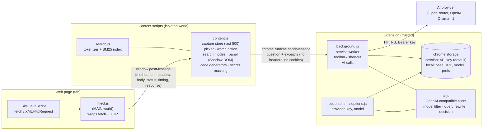
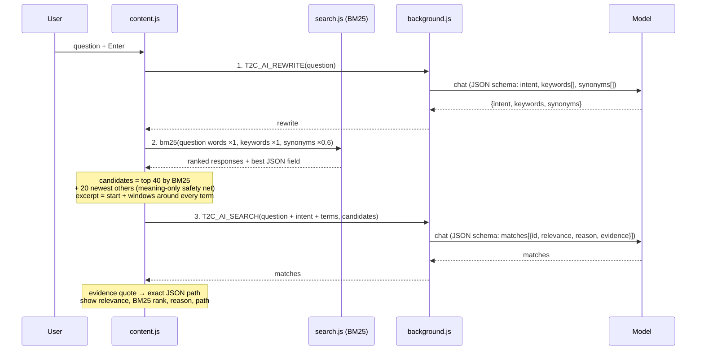

# Text2Curl architecture

## 1. Components

| File | World | Job |
|---|---|---|
| `inject.js` | page (MAIN) | Wraps `fetch` and `XMLHttpRequest` at `document_start`; posts one record per finished request (text/JSON up to 2 MB, plus status, timing, errors). |
| `search.js` | content script | Tokenizer (Unicode, camelCase / snake_case split, Persian/Arabic normalisation, light English stemming) and BM25 index per response. |
| `content.js` | content script | Stores the last 500 records, picker, *Watch action*, the three search modes, the AI pipeline orchestration, the panel UI, code generators (cURL / fetch / Python), secret masking. |
| `background.js` | service worker | Toolbar / shortcut toggle. Runs every AI request, so the API key never enters a web page. Accepts messages only from its own extension. |
| `ai.js` | service worker + options page | OpenAI-compatible client: model listing, filtering and ranking; structured-output calls with fallback; query rewrite; decision. |
| `options.*` | extension page | Provider (Base URL), API key, model picker, connection test. |

## 2. Search modes

| Mode | Where it runs | Cost | Finds |
|---|---|---|---|
| **Exact** | local | free | Responses containing the value as typed (normalised: case, spaces, `1,250` = `1250`, Persian digits). |
| **BM25** | local | free | Ranked keyword search. Matches words in values **and** field names (`ticket status` → `$.tickets[0].status`). |
| **✨ AI** | local + your provider | tokens | Meaning: related terms, synonyms, abbreviations, translations, then a model decides. |

## 3. AI pipeline (retrieve, then decide)

### Step 1: query rewrite
The model turns the question into `intent`, `keywords` (exact data terms, codes and abbreviations kept as written)
and `synonyms` (variants, plural/singular, abbreviation ↔ full form, English/Persian translations, likely JSON field names).
If this step fails for a non-auth reason, the pipeline continues with the original words.

### Step 2: BM25 retrieval (local)
- Document = one response. JSON leaves are indexed as `"<last key> <value>"`.
- Score: `Σ w(t) · idf(t) · tf·(k1+1) / (tf + k1·(1 − b + b·len/avglen))`, `k1 = 1.2`, `b = 0.75`,
  `idf = ln(1 + (N − df + 0.5)/(df + 0.5))`.
- Weights: original words 1.0, AI keywords 1.0, AI synonyms 0.6.
- Best field: the JSON leaf covering the most idf-weighted query terms → reported path.

### Step 3: decision
- Candidates: top 40 BM25 hits plus the 20 newest other responses (so a match by meaning only still has a chance).
- Each candidate sent as `id, method, URL (secrets masked), status, excerpt` (≈ 0.9 to 3 KB).
- Batches of ≈ 60k characters, at most 4.
- The model must return `relevance`, a one-line `reason`, and an exact `evidence` quote; Text2Curl maps the quote back to a JSON path so every answer can be checked.
- If the decision fails, the BM25 results (with the expanded terms) are shown instead.

### Structured output ("type-safe" answers)
Every AI call asks for an exact JSON schema (`response_format: json_schema, strict: true`).
If the model or provider rejects it (HTTP 400/422) Text2Curl retries with `json_object`, then plain text,
and parses the first JSON object in the answer. Auth, quota and network errors stop immediately. Temperature is 0.

### Model selection
`GET {baseUrl}/models`, then:
1. **Hide** models that cannot read text and answer in text: by provider metadata (input/output modalities, `type`,
   `capabilities.completion_chat`) and by name (embedding, rerank, whisper / tts / audio / realtime, image and video
   generators, moderation / guard).
2. **Rank:** JSON-schema support → JSON mode → unknown → none; then context ≥ 32k; then price.
3. **Recommend:** cheapest paid model with JSON schema and ≥ 64k context.

## 4. Security and privacy

| Concern | Design |
|---|---|
| API key exposure to pages | Key is read and used only in the service worker; pages and content scripts never receive it. |
| Key at rest | Default `chrome.storage.session` (memory, erased on browser close, `TRUSTED_CONTEXTS` only). Optional "Remember" → `chrome.storage.local`. Never `storage.sync`. "Delete key" button. |
| Message spoofing | Background accepts messages only where `sender.id === chrome.runtime.id`. |
| Data sent to the AI | Only when the user presses Search in AI mode. Question + short excerpts + URLs with secret query params masked. No headers, no cookies. |
| Host access for the AI | `optional_host_permissions`, requested for the chosen provider's origin only, when the user loads models / saves. |
| Secrets in copied code | "Hide secrets" (default on) masks auth headers, cookies, API keys, tokens and passwords in headers, URL and body. |
| Page styles / scripts | Panel lives in a Shadow DOM; the capture store is in the isolated world. |

## 5. Data limits

| Item | Limit |
|---|---|
| Captured requests per tab | 500 (oldest dropped) |
| Response text stored | 2 MB each |
| JSON leaves indexed | 20 000 per response |
| AI candidates | 40 BM25 + 20 recent |
| AI batch | ≈ 60k characters, max 4 batches |
