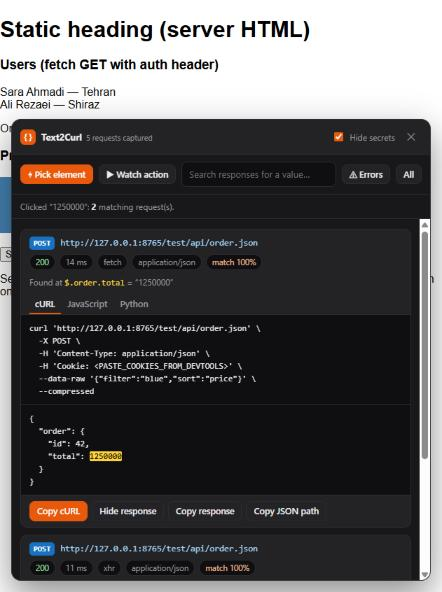

<p align="center"></p>

<h1 align="center">Text2Curl</h1>

<p align="center">
<b>Click any text or image on a web page and get the API request behind it: as cURL, JavaScript or Python, with the full response.</b><br>
<sub>Chrome extension · Manifest V3 · no servers, no tracking</sub>
</p>

<p align="center"></p>

---

## Why

Finding which API call produced a value on a page usually means digging through the DevTools
**Network** tab: opening request after request and searching responses by hand.
Text2Curl does that for you. Click the value, get the request.

## Features

| | |
|---|---|
| ⌖ **Pick element** | Hover highlights elements; click a text or image to find the request whose response contains it. |
| ▶ **Watch action** | Click a button, link or filter; see every request it sends. Great for "what does *Save* call?". |
| 🔍 **Search, 3 modes** | **Exact** (value as typed), **BM25** (ranked keywords, local, free), **✨ AI** (meaning: rewrites your question, retrieves with BM25, a model decides). Finds values even if they are not shown on the page. |
| `</>` **Code** | Copy as **cURL**, **JavaScript** (`fetch`) or **Python** (`requests`). |
| 📄 **Response** | Pretty-printed response with the matched value highlighted; copy it in one click. |
| 🧭 **JSON path** | Exactly where the value lives, e.g. `$.users[0].name`. |
| 🔒 **Hide secrets** | On by default: masks `Authorization`, cookies, tokens, API keys and passwords before you copy or share. |
| ⏱ **Timing & errors** | Status and response time for every request; an **Errors** view for 4xx/5xx and network failures. |
| 🌐 **Smart matching** | Ignores case and spacing; `1,250,000` = `1250000`; understands Persian/Arabic digits; ranks results by match quality. |

| ✨ **AI search** *(optional)* | Ask in plain language, e.g. *"which APIs mention refunds?"*. Bring your own model: OpenRouter, OpenAI, Groq, DeepSeek, Mistral, Together, or a local Ollama / LM Studio. |

Everything stays in your browser. Text2Curl has no server, no analytics and no remote code. AI search sends data only to the provider you configure, only when you use it. See [PRIVACY.md](PRIVACY.md).

## Use cases

### For developers
- **Find the endpoint behind a UI value.** You see a wrong price, name or count on a page. Click it, and you get the exact
  request and the JSON path (`$.items[3].price.amount`), so you know whether the bug is in the API or in the front end.
- **Reproduce a request in the terminal.** Copy the cURL, paste it, run it. No need to rebuild headers and body by hand.
- **Start a script or integration.** Copy the request as Python (`requests`) or JavaScript (`fetch`) and build on it.
- **Learn an unfamiliar codebase or a legacy app.** Click around and discover which endpoints each screen uses,
  without reading the source first.
- **See what a button really sends.** *Watch action* on *Save*, *Delete*, *Apply filter*, *Next page*: you see the method,
  URL, query parameters and body of every request that click triggers.
- **Understand filters, sorting and pagination.** Change a filter with *Watch action* on, and compare the query
  parameters (`?page=2&sort=price`) between requests.

### For QA and testers
- **Write precise bug reports.** Attach the cURL (with *Hide secrets* on) and the response, so developers can reproduce the issue directly.
- **Spot failing calls fast.** The **Errors** view lists every 4xx/5xx and network failure on the page.
- **Find slow requests.** Every request shows its response time; slow ones (≥ 1 s) are highlighted.
- **Check what the server actually returned.** *Show response* tells you whether a wrong value came from the server or from the page.

### For data analysts and researchers
- **Get the raw data behind a table or chart.** Click a cell or a label; you get the API that feeds it, often with more
  fields than the page shows. Copy the response as JSON.
- **Find a value that is not on screen.** Use the search box to find which response contains an ID, a code or a hidden field.

### For support and product teams
- **Answer "where does this number come from?"** without opening DevTools.
- **Share a request safely.** *Hide secrets* masks tokens, cookies, API keys and passwords before you copy.

### Example: from a price on a shop page to a script

1. Reload the product page and press `Alt+Shift+C`.
2. Click the price **£89.50**.
3. Text2Curl shows `GET https://shop.example/api/products/7731`, *Found at* `$.price.amount = "89.5"`.
4. Switch to the **Python** tab and click **Copy Python**. You now have a working script that fetches the price.

> Use Text2Curl only on sites and APIs you are allowed to access, and respect their terms of service.

---

## Install (Developer Mode)

Text2Curl is not on the Chrome Web Store yet, so you install it as an *unpacked* extension.
It takes about one minute.

### Step 1: Download the code

**Option A: ZIP (no tools needed)**
1. On this GitHub page click the green **Code** button → **Download ZIP**.
2. Unzip it. You get a folder such as `text2curl-main`.
3. Move that folder somewhere permanent (e.g. `Documents/Extensions/`).
   The browser loads the extension **from this folder**, so do not delete or move it later.

**Option B: Git**
```bash
git clone https://github.com/mhmsadegh/text2curl.git
```

### Step 2: Load it in your browser

<details open>
<summary><b>Google Chrome</b></summary>

1. Open a new tab and go to `chrome://extensions`
   (or menu ⋮ → **Extensions** → **Manage Extensions**).
2. Turn on **Developer mode** (switch in the top-right corner).
3. Click **Load unpacked** (top-left).
4. Select the folder from Step 1: the one that contains `manifest.json`.
5. Text2Curl appears in the list. Make sure its switch is **on**.
6. Pin it: click the puzzle icon 🧩 in the toolbar → click the pin 📌 next to **Text2Curl**.
</details>

<details>
<summary><b>Microsoft Edge</b></summary>

1. Go to `edge://extensions`.
2. Turn on **Developer mode** (left sidebar, bottom).
3. Click **Load unpacked** and select the folder that contains `manifest.json`.
4. Pin it from the puzzle icon in the toolbar.
</details>

<details>
<summary><b>Brave, Opera, Vivaldi, Arc and other Chromium browsers</b></summary>

- Brave: `brave://extensions`
- Opera: `opera://extensions`
- Vivaldi: `vivaldi://extensions`
- Arc: `arc://extensions`

Turn on **Developer mode**, click **Load unpacked**, select the folder that contains `manifest.json`.
</details>

> Firefox and Safari are not supported.

### Step 3: Try it

1. Open any website and **reload the page** (Text2Curl only sees requests made after the page starts loading).
2. Press **`Alt+Shift+C`** or click the Text2Curl icon.
3. Click a text or image. The panel shows the matching request.

### Updating

- **ZIP:** download the new ZIP, replace the files in the same folder, then on `chrome://extensions` click the
  ↻ **reload** icon on the Text2Curl card.
- **Git:** run `git pull` in the folder, then click ↻ **reload** on the Text2Curl card.

Reload open tabs afterwards so the new version is injected.

### Uninstall

`chrome://extensions` → **Remove** on the Text2Curl card. You can then delete the folder.

### Install troubleshooting

| Problem | Fix |
|---|---|
| "Manifest file is missing or unreadable" | You selected the wrong folder. Pick the folder that directly contains `manifest.json` (unzipping sometimes creates a folder inside a folder). |
| Nothing happens on `Alt+Shift+C` | Another extension may use the shortcut. Set your own at `chrome://extensions/shortcuts`, or click the toolbar icon. |
| "No requests captured yet" | Reload the page after installing or enabling the extension. |
| It does not work on `chrome://` pages or the Chrome Web Store | Browsers block extensions there. This is expected. |
| Chrome shows "Disable developer mode extensions" on start-up | Normal for unpacked extensions. Click ✕ to keep it. |
| Company-managed browser does not allow Developer mode | Your admin policy blocks unpacked extensions. |

---

## How to use

| Action | How |
|---|---|
| Open the picker | `Alt+Shift+C` or the toolbar icon |
| Find the API of a text / image | **⌖ Pick element** → click it |
| Find what a button calls | **▶ Watch action** → click the button (the click works normally) |
| Find a value not on screen | Pick **Exact** or **BM25** in the search box, type it |
| Ask in plain language | Pick **✨ AI**, type the question, press `Enter` or **Search** (needs AI setup) |
| See failing calls | **⚠ Errors** |
| See everything captured | **All** |
| Switch code language | **cURL / JavaScript / Python** tabs (remembered) |
| Show / copy the response | **Show response**, **Copy response** |
| Cancel or close | `Esc` |

### Hide secrets

With **Hide secrets** on (default), values whose names look sensitive are replaced by `<REDACTED>`:
headers such as `Authorization`, `Cookie`, `X-API-Key`, `X-CSRF-Token`; URL parameters such as `api_key`, `token`;
and JSON or form fields such as `password`, `access_token`. Turn it off when you want to run the request yourself.

### Cookies

Page scripts cannot read `HttpOnly` cookies. When a request would normally send cookies, the code contains
`Cookie: <PASTE_COOKIES_FROM_DEVTOOLS>`. If the API needs a login, copy the cookie from DevTools
(**Application → Cookies**, or the request's `Cookie` header) and paste it in. Remove the line if it is not needed.

### When nothing is found

- The value is in the **server-rendered HTML**, not loaded by an API.
- The page was opened **before** the extension was enabled. Reload it.
- It came over a **WebSocket**, Server-Sent Events or a Service Worker cache.
- The page **changed the value** before showing it (date formats, translations, rounding). Try the search box with part of the value.

---

## ✨ AI search (optional)

Keyword search finds exact values. AI search finds **meaning**: *"which responses mention refunds?"*, *"where are the shipping costs?"*,
*"which API returns the logged-in user's profile?"*, *"anything about refunds or errors?"*.

### Set it up (once)

1. Right-click the Text2Curl icon → **Options**, or open `chrome://extensions` → Text2Curl → **Details** → **Extension options**.
   You can also click **AI settings** inside the panel.
2. **Base URL**: click a preset or type any OpenAI-compatible URL:

   | Provider | Base URL |
   |---|---|
   | OpenRouter (hundreds of models, one key) | `https://openrouter.ai/api/v1` |
   | OpenAI | `https://api.openai.com/v1` |
   | Groq | `https://api.groq.com/openai/v1` |
   | DeepSeek | `https://api.deepseek.com/v1` |
   | Mistral | `https://api.mistral.ai/v1` |
   | Together | `https://api.together.xyz/v1` |
   | Ollama (local, free, private) | `http://localhost:11434/v1` |
   | LM Studio (local) | `http://localhost:1234/v1` |

3. **API key**: paste your key (leave empty for Ollama / LM Studio).
4. Click **Load models**. Chrome asks permission to contact that provider: allow it.
5. Pick a model (one is marked **recommended**), click **Save**, then **Test connection**.

### Smart model list

Providers return every model they have, including many that cannot do this job. Text2Curl filters and ranks them:

- **Hidden automatically:** embedding models, image and video generators, speech-to-text / text-to-speech, audio and realtime models,
  moderation and safety classifiers, rerankers. They cannot read API responses and answer, so they are useless here.
  Detection uses the provider's metadata (input/output modalities, model type, capabilities) plus model-name patterns.
- **Ranked first:** models that support **structured output (JSON schema)**. Their answers are type-safe: the extension asks for an
  exact schema (`{matches: [{id, relevance, reason, evidence}]}`), so answers always parse.
- Then models with a large context window, then cheaper ones.
- **Recommended:** the cheapest paid model with JSON-schema support and at least 64k context.
- Filters: *Only structured output*, *Only free*, and text search. You can also type any model id by hand.

If a model rejects JSON schema, Text2Curl falls back to JSON mode, then to plain text, automatically.

### Use it

1. Open the panel (`Alt+Shift+C`, then `Esc` to leave pick mode, or click the icon twice).
2. In the search box choose **✨ AI**, type your question, press **Enter** or **Search**.
3. Each result shows the request, an **AI relevance** score, the AI's one-line **reason**, and the **JSON path of the evidence**.
   All the usual buttons work: copy as cURL / JavaScript / Python, show the response.

### How AI search works: retrieve, then decide

1. **Understand** · the model rewrites your question into keywords and related terms
   (synonyms, plural/singular, abbreviations, English/Persian, likely JSON field names). Shown as *Searched for* chips.
2. **Retrieve** · local BM25 ranks every captured response with those terms (no AI, no cost).
3. **Decide** · the model reads short excerpts of the top 40 candidates (plus the 20 newest others, in case a match shares no word)
   and returns relevance, a reason and an exact evidence quote. Text2Curl maps the quote to its JSON path.

Example: you ask *"which APIs mention refunds?"*. A response only says *"Reimbursement for a damaged lamp"*.
BM25 alone finds nothing; the rewrite adds *reimbursement*, BM25 retrieves it, the model confirms it.

- Only **short excerpts** are sent (start of the response plus windows around the terms). Headers and cookies are never sent.
- Answers use a strict JSON schema (type-safe), temperature 0.
- If the AI step fails, you still get the BM25 results with the expanded terms.

Full design: [ARCHITECTURE.md](ARCHITECTURE.md).

### Security of your API key

- Stored **only inside the extension**, never in the web page. Pages and other extensions cannot read it.
- By default it is kept **in memory only** (`chrome.storage.session`) and erased when the browser closes.
  Tick **Remember the key** to keep it on this computer (`chrome.storage.local`). It is never synced to your Google account.
- AI calls are made by the extension's background worker, so the key is never exposed to the page you are inspecting.
- **Delete key** removes it at any time.
- Tip: create a separate key with a spending limit for Text2Curl. With OpenRouter you can set a credit limit per key.

> When you run an AI search, excerpts of that page's API responses are sent to the provider you chose.
> Do not use it on pages with data you are not allowed to share. Use a local model (Ollama) for full privacy.

---

## How it works

| File | Role |
|------|------|
| `inject.js` | Runs in the page's own JavaScript world at `document_start`. Wraps `fetch` and `XMLHttpRequest` and records method, URL, request headers, body, status, timing and response text (text/JSON up to 2 MB). |
| `content.js` | Keeps the last 500 requests, runs the picker, action watcher and search, generates code and draws the panel inside a Shadow DOM (page styles cannot break it). |
| `background.js` | Opens the picker from the toolbar icon and the keyboard shortcut; runs AI requests so the key never reaches the page. |
| `search.js` | Local search engine: tokenizer and BM25 ranking (values and JSON field names). |
| `ai.js` | OpenAI-compatible client: model list filtering and ranking, structured-output search with fallbacks. |
| `options.html`, `options.js` | AI settings page. |
| `manifest.json` | Manifest V3 configuration. |

### Limitations

- Headers added by the browser itself (`User-Agent`, `Referer`, `Cookie`, `Origin`) are invisible to page scripts, so they are only in the code if the page set them.
- WebSockets, Service-Worker requests and requests made by other extensions are not captured.
- Binary responses (images, files) are listed but not searched.

## Development

A sample page with `fetch`, `XMLHttpRequest`, an image from JSON, a click action, a hidden value and a 404 is included:

```bash
python test/serve.py 8765
```

Open `http://127.0.0.1:8765/test/index.html` with the extension loaded.
`test/harness.html` loads the scripts directly, so you can test without installing the extension.
The same server offers a **mock** OpenAI-compatible endpoint at `http://127.0.0.1:8765/mock/v1` for testing AI search
without a real key. It is not an AI: it only reports responses that contain a word of the question.

See [CHANGELOG.md](CHANGELOG.md) for versions.

## License

[MIT](LICENSE)
